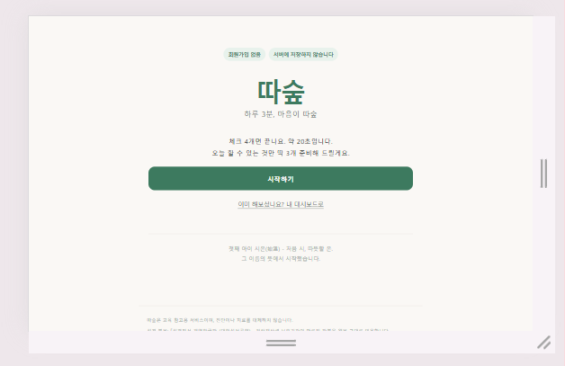
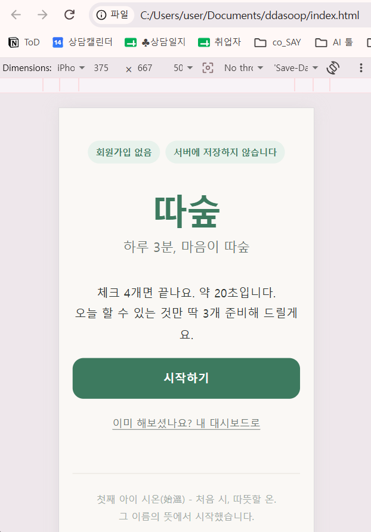
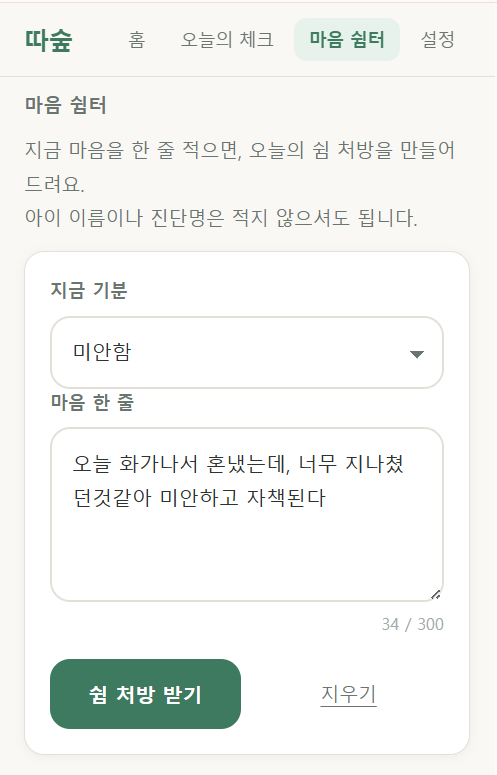

# 따숲 (ddasoop)

> 하루 3분, 마음이 따숲

지친 자폐/발달장애 아동 부모를 위한 홈코칭 서비스입니다.
오늘의 기분 하나 고르고, 마음을 한 줄 적고, 버튼을 누르면 AI가 공감과
오늘의 작은 실천 하나를 카드로 돌려줍니다.

- 배포 URL: https://ddasoop.vercel.app
- 서비스 기획서: [docs/service-plan.md](docs/service-plan.md)
- 개발 보고서(과제요건 대조): [report.md](report.md)

## 스크린샷

| 데스크톱 | 모바일 | AI 기능 |
| --- | --- | --- |
|  |  |  |

## 목차

- [주요 기능](#주요-기능)
- [페이지 구성](#페이지-구성)
- [기술 스택](#기술-스택)
- [폴더 구조](#폴더-구조)
- [실행 방법](#실행-방법)
- [환경 변수 설정](#환경-변수-설정)
- [개인정보](#개인정보)
- [고지](#고지)
- [이름의 유래](#이름의-유래)

## 주요 기능

- **오늘의 체크** — 오늘의 기분 등 상태를 짧게 기록합니다.
- **대시보드** — 기록이 쌓일수록 레벨과 새싹 그래픽이 성장하고, 오늘의
  미션 3개를 함께 안내합니다.
- **행동 코칭 (v2 추가)** — 아이 행동을 A(직전 상황)·B(행동)·C(직후 결과)
  세 번 눌러 기록하고, 10건 이상 쌓이면 기능 가설(회피·관심·물건획득·감각·신체)과
  이번 주 실천 1개를 보여줍니다. 유치원 알림장이나 음성메모 녹취를 붙여 넣으면
  AI가 ABC 정리, 가설, 실천, 선생님께 보낼 메시지까지 만들어 줍니다.
- **폰 앱 설치 (PWA, v2 추가)** — 홈 화면에 설치하면 앱처럼 전체 화면으로 열리고,
  인터넷이 없어도 기록할 수 있습니다. 백업 파일로 폰을 바꿔도 기록을 옮길 수 있습니다.
- **마음 쉼터 (AI)** — 기분 선택 + 한 줄 메모를 입력하면 AI가 공감과
  오늘의 실천 제안을 담은 카드를 만들어 줍니다. 이 서비스의 핵심 AI
  기능입니다.

기능별 입력/출력/실패 처리 기준 등 자세한 내용은
[서비스 기획서](docs/service-plan.md)를 참고하세요.

## 페이지 구성

랜딩 → 온보딩 → 오늘의 체크 → 대시보드(허브) ⇄ 설정 / 마음 쉼터(AI) 순으로
이동하며, 상단 내비게이션으로 언제든 다른 섹션으로 전환할 수 있습니다.
자세한 구성과 이동도는 [서비스 기획서](docs/service-plan.md)를 참고하세요.

## 기술 스택

- 프론트엔드: HTML / CSS / JavaScript (프레임워크 미사용)
- 백엔드: Vercel Serverless Functions (Python 3.14, `api/generate.py`)
- AI: Google Gemini API (`gemini-flash-latest`)
- 저장소: 브라우저 localStorage (서버 저장 없음)

## 폴더 구조

```
ddasoop/
├── index.html            프런트 진입점 (6개 view 섹션 포함)
├── css/
│   └── style.css         레이아웃 + 반응형 스타일
├── js/
│   ├── app.js             화면 전환, 이벤트 바인딩
│   ├── ai.js               fetch('/api/generate') 호출, 결과 렌더링
│   ├── storage.js         localStorage 기록 저장
│   ├── behavior.js        행동 코칭: ABC 기록 · 패턴 · 상황 코칭 · 이번 주 실천
│   ├── backup.js          백업 파일 내보내기 · 복원
│   ├── pwa.js             홈 화면 설치 · 서비스워커 등록 · 업데이트 안내
│   ├── data.js / verses.js  미션·성경 구절 데이터
│   └── fallback.js         AI 실패 시 대비 문구
├── api/
│   ├── generate.py         Vercel Serverless Function (Python) ← 마음 쉼터
│   ├── coach.py            Vercel Serverless Function (Python) ← 상황 코칭
│   └── requirements.txt    requests==2.32.3
├── sw.js                  서비스워커 (오프라인 · 업데이트)
├── manifest.webmanifest   앱 이름 · 아이콘 · 설치 정보
├── icons/                 앱 아이콘 (192, 512, maskable, apple-touch)
├── tests/                 API 단위 테스트 · 로컬 서버 · E2E
├── images/                캡처 증빙
├── docs/
│   └── service-plan.md     서비스 기획서
├── report.md               개발 보고서 (과제요건 대조)
├── .env.example            GEMINI_API_KEY 키 이름만 포함
├── .gitignore              .env 등 민감 파일 제외
└── vercel.json              프레임워크 자동 감지 해제 설정
```

## 폰에 설치하기

| 폰 | 방법 |
| --- | --- |
| 안드로이드 (Chrome) | https://ddasoop.vercel.app 접속 → 화면의 **홈 화면에 설치** 버튼, 또는 메뉴(⋮) → **앱 설치** |
| 아이폰 (Safari) | Safari로 접속 → 아래 공유 버튼(□↑) → **홈 화면에 추가** → **추가** |

카카오톡 안에서 링크를 열면 설치가 안 됩니다. 메뉴에서 "다른 브라우저로 열기"를 먼저 누르세요.

### 카톡 메시지를 바로 코칭받기

- **안드로이드(앱 설치 후)**: 카톡 메시지 길게 누르기 → 공유 → **따숲** → 상황 코칭 입력칸에 자동으로 들어갑니다.
  공유받은 글은 서비스워커가 기기 안에서 처리해 서버 접속 기록에 남지 않습니다.
- **아이폰**: 카톡에서 메시지 복사 → 따숲 상황 코칭의 **카톡 내용 붙여넣기** 버튼.
  (iOS는 웹앱 공유 대상 기능을 지원하지 않습니다.)

### 안정성 설계

| 위험 | 대응 |
| --- | --- |
| 인터넷이 끊김 | 서비스워커가 앱 화면을 기기에 저장. 오프라인에서도 열리고 기록됨. 상황 코칭은 기본 가이드로 대체 |
| AI 서버 장애·키 누락 | `/api/coach` 실패 시 화면에서 기본 가이드로 자동 대체. 앱은 멈추지 않음 |
| 폰 교체·브라우저 데이터 삭제 | 백업 파일 내보내기/복원. 브라우저에 데이터 영구 보존 요청. 기록 5건 이상이고 7일 넘게 백업 안 하면 알림 |
| 기록 도중 새 버전 배포 | 새 버전은 "업데이트" 버튼을 누를 때만 적용 |
| 잘못된 백업 파일 | 형식 검증 후 거부. 복원 실패 시 기존 기록 되돌림 |
| 개인정보 | 기록은 기기 안에만 저장. AI로 보낼 때 아이 별명·가릴 이름은 `[아이]` `[이름1]`로 바꾸고 전화번호·주민번호 삭제. 서버 로그에는 상태 코드만 남김. `/api/`는 캐시하지 않음 |
| 외부 스크립트 주입 | `vercel.json`에 CSP(`script-src 'self'`) 등 보안 헤더 적용. 외부 CDN 없음 |

### 새 버전 배포할 때

`sw.js`의 `VERSION` 값을 올린 뒤 배포하면 사용자 화면에 "업데이트" 버튼이 뜹니다.
깜빡해도 파일은 다음 실행 때 백그라운드에서 갱신됩니다.

### 테스트

```bash
python3 -m unittest discover -s tests -p "test_*.py"   # /api/coach 단위 테스트 (13개)
python3 tests/dev_server.py 8787 &                      # AI 응답을 흉내 내는 로컬 서버
python3 tests/e2e_app.py                                # 폰 화면 E2E (37개 항목)
```

## 실행 방법

### 로컬 실행 (Vercel CLI)

```bash
npm install -g vercel
vercel dev
```

브라우저에서 `http://localhost:3000` 접속. 프런트(`index.html`, `css/`, `js/`)와
`api/generate.py`가 함께 실행되어 AI 기능까지 로컬에서 테스트할 수 있습니다.

### 배포

GitHub 저장소를 Vercel 프로젝트에 연결하면, `main` 브랜치에 푸시할 때마다
자동으로 재배포됩니다. `vercel.json`에서 프레임워크 자동 감지를 꺼 두었으므로
정적 파일과 `api/` 함수가 함께 인식됩니다.

## 환경 변수 설정

| 변수명 | 설명 | 발급처 |
| --- | --- | --- |
| `GEMINI_API_KEY` | Gemini API 호출에 사용하는 키 | https://aistudio.google.com/apikey |

1. 저장소 루트의 `.env.example`을 복사해 `.env`로 이름을 바꾸고, 발급받은 키 값을 입력합니다.
2. `.env`는 `.gitignore`에 등록되어 있어 저장소에 올라가지 않습니다.
3. Vercel 배포 환경에는 로컬 `.env`가 자동으로 반영되지 않으므로,
   Vercel 프로젝트 설정 → Environment Variables에 `GEMINI_API_KEY`를 **Sensitive** 타입으로
   직접 등록한 뒤 재배포해야 합니다.

## 개인정보

이 서비스는 아이의 정보를 서버에 저장하지 않습니다.
모든 기록은 사용자의 브라우저 안에만 남습니다.
실명, 생년월일, 진단명, 연락처, 사진을 입력받지 않습니다.

## 고지

따숲은 교육 참고용 서비스이며, 진단이나 치료를 대체하지 않습니다.

성경 본문: 『성경전서 개역한글판』(대한성서공회)
저작재산권 보호기간이 만료된 판본을 원문 그대로 인용합니다.

## 이름의 유래

첫째 아이 시온(始溫) — 처음 시, 따뜻할 온.
그 이름의 뜻에서 시작했습니다.
따뜻함이 하루씩 쌓여 숲이 된다는 뜻으로 '따숲'이라 이름 붙였습니다.
