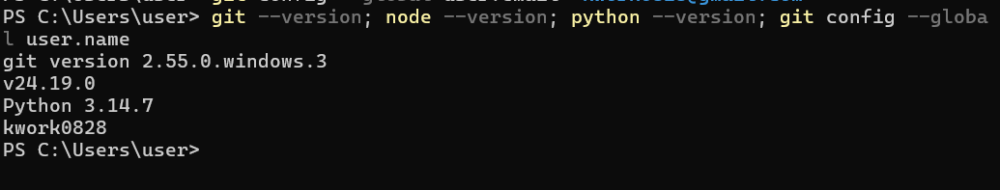
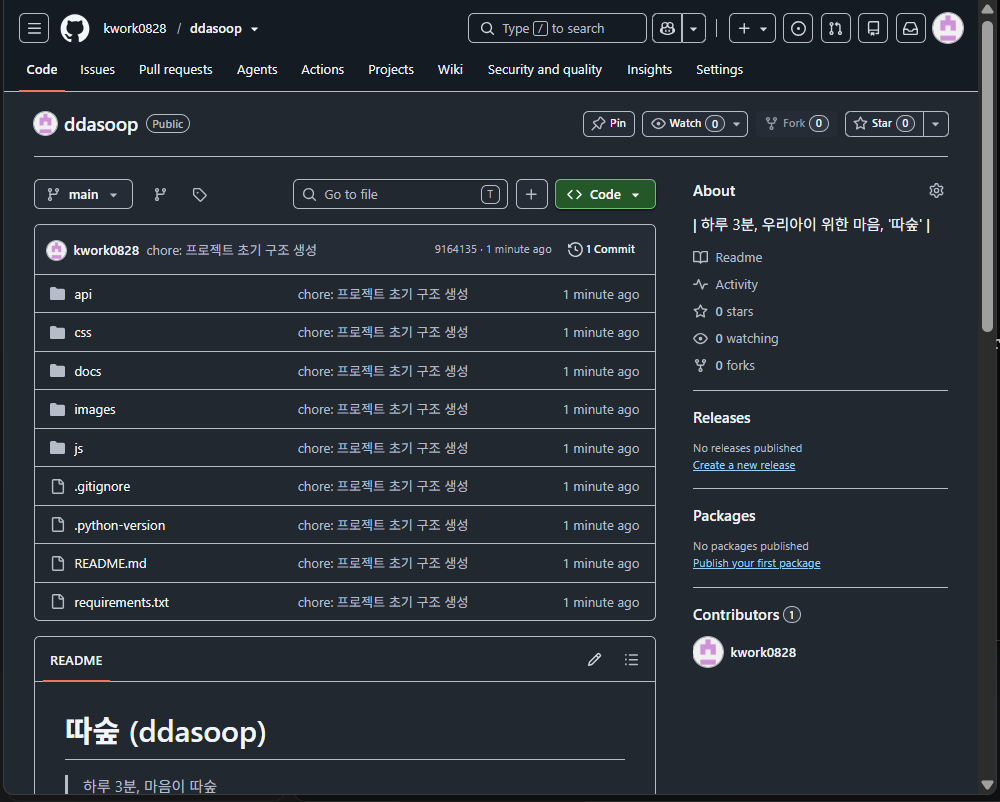
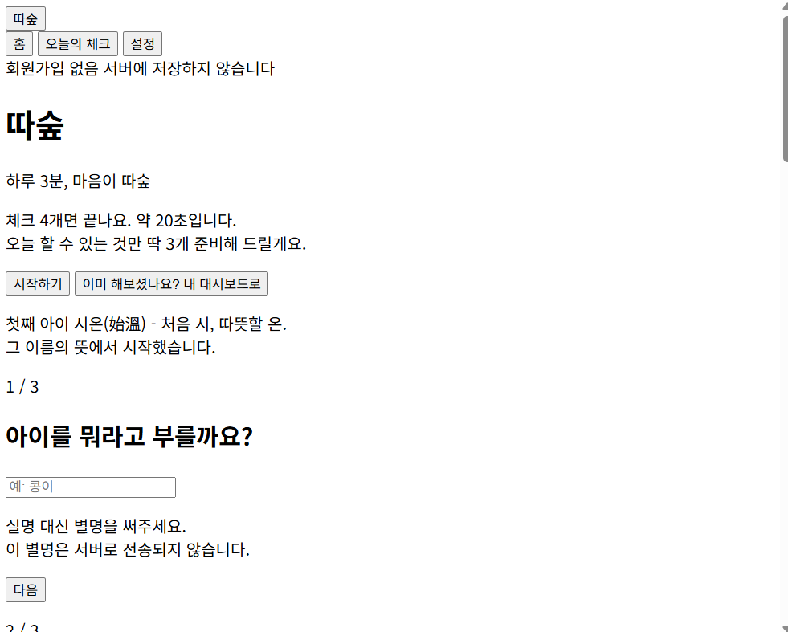
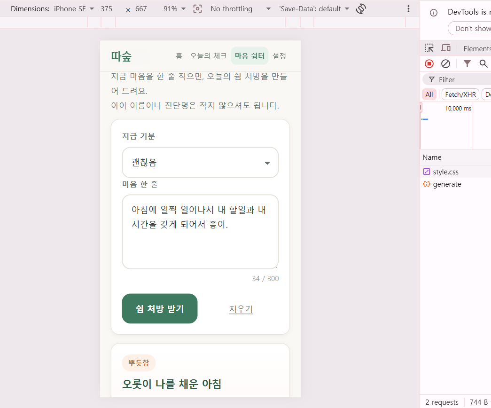
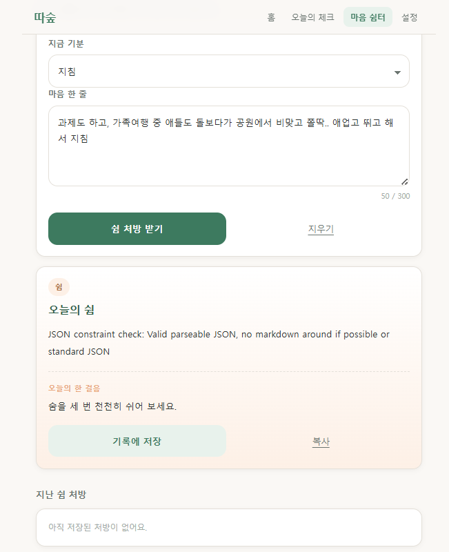
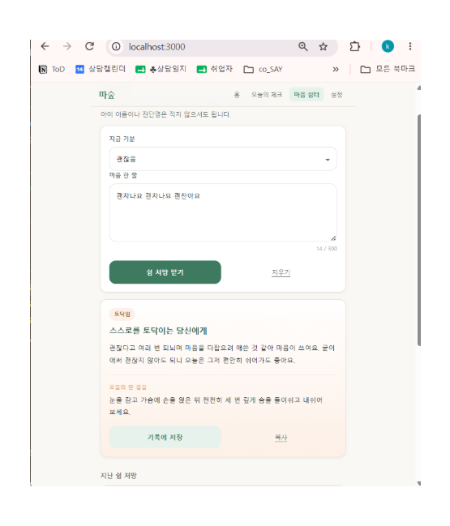
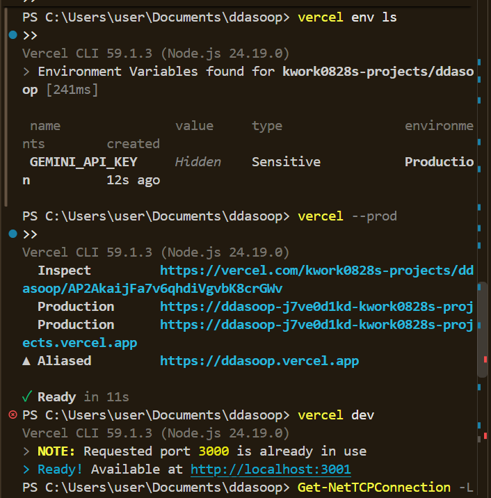
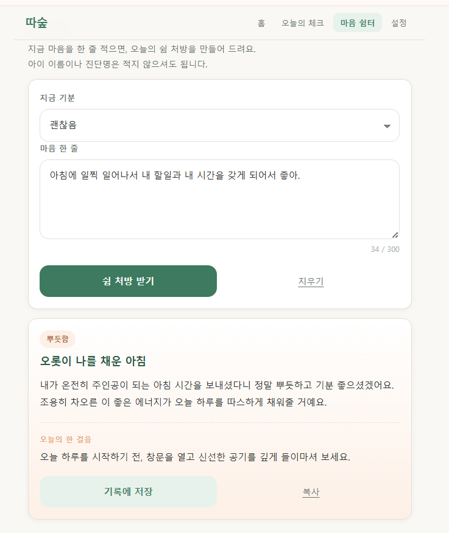
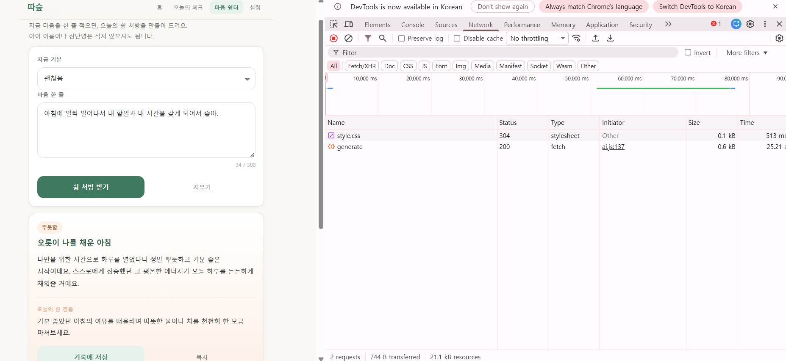
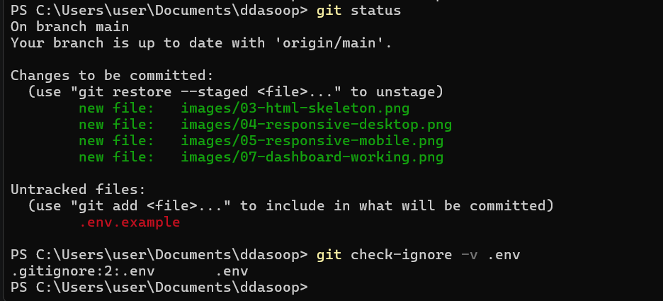

# 따숲(ddasoop) 개발 보고서 — 과제요건 대조

하루 3분, 마음이 따숲 — 육아로 지친 마음을 위한 AI 쉼 처방 웹앱

- 배포 주소: https://ddasoop.vercel.app
- 저장소: https://github.com/kwork0828/ddasoop
- 작성자 / 기간: kwork0828 / 2026년 8월

---

## 0. 이 보고서를 읽는 방법

이 보고서는 "AI 웹 개발: 내 아이디어를 현실로, AI 웹 서비스 빌딩" 과제요건 원문의
순서를 그대로 따라가며 쓰였습니다. 각 절 맨 위에 과제요건 원문을 인용하고, 그
아래에 따숲이 그 요건을 어떻게 충족했는지 근거(코드, 화면, 이미지)와 함께
설명합니다. 항목마다 다음 세 가지 표시 중 하나를 붙였습니다.

- ✅ 충족 — 요건을 만족하는 근거가 실제로 존재함
- ⚠️ 보완 필요 — 부분적으로만 되어 있거나, 제출 전 채워야 할 부분이 남아 있음
- ⬜ 미적용(선택) — 보너스 등 선택 항목 중 이번에는 적용하지 않은 것

충족되지 않은 항목을 충족된 것처럼 적지 않고, 남은 일은 남은 일이라고 그대로
적었습니다.

---

## 1. 미션 소개 — 어떤 문제에서 출발했는지

> 아이디어는 있는데, 개발자가 없어서 못 만든다? … AI가 맞춤 추천을 해주거나,
> 문의에 자동 응답하거나, 텍스트를 생성하는 기능을 직접 만들어보세요.

아이를 돌보다보면 잠깐 쉬기도 어렵습니다. 바쁘게 지내다보니 첫째 아이의
자폐치료에 정작 가족이 같이 뭔가를 생각하고 실천하기도 어려웠습니다. 그래서 긴
상담이나 거창한 계획이 아니라, "지금 그 마음이 그럴만하다"는 한마디, 그리고
5분 안에 해볼 수 있는 작은 행동 하나를 매일 할 수 있게 만들어보고 싶었습니다.

흑백요리사에 나왔던 프렌치파파 분도 인터뷰에서, 자녀가 자폐 검사를 시도하는
그것부터도 너무 어려웠고 장벽이 느껴졌다는 말을 했는데 저도 공감했습니다.
그래서 따숲이라는 서비스를 만들었고, 오늘의 기분 하나 고르고, 마음을 한 줄
적고, 버튼을 누르면 끝입니다. 서비스 이름은 첫째 아이의 이름 시온(始溫), 처음
시와 따뜻할 온에서 가져왔습니다. 저 혼자 뿐 아니라 자폐치료 까페에 다른
부모님들에게도 보여주면서 더 다양한 가능성을 확장시켜서, 지금은 저 혼자 나무
한 그루 심은 것이지만 이후에는 숲이 될 수 있게 여는 문이 되고 싶어서
이름지었습니다.

아이 이름이나 진단명 같은 민감한 정보는 처음부터 요구하지 않고, 회원가입도
두지 않았습니다. 그래서 첫 화면에 "회원가입 없음, 서버에 저장하지 않습니다"를
먼저 보여주었습니다.

✅ 충족 — "시키는 대로"가 아니라 실제 생활의 문제 정의에서 출발해, AI 기능
(마음 쉼터)을 포함한 웹 서비스로 구현·배포했습니다. (근거: 3장, 5-7절)

---

## 2. 최종 결과물 — 제출 패키지 5종 체크

### 2-1. 배포된 웹 서비스 (Vercel URL)

> 최소 3개 이상의 페이지/섹션, 반응형, AI API 연동 기능 1개 이상(입력→결과 출력)

| 세부 요건 | 상태 | 근거 |
| --- | --- | --- |
| 3개 이상 페이지/섹션 + 메뉴 이동 | ✅ 충족 | 랜딩·온보딩·오늘의 체크·대시보드·설정·마음 쉼터(AI) 총 6개 섹션, 상단 `nav`로 이동 (4장) |
| 반응형(모바일 정상 표시) | ✅ 충족 | iPhone SE 375px 기준 최적화, 데스크톱/모바일 캡처 확인 (5-4절) |
| AI API 연동 기능(입력→출력) | ✅ 충족 | 마음 쉼터: 기분·한 줄 메모 입력 → Gemini 호출 → 공감 카드 출력 (5-6절, 6장) |

### 2-2. GitHub 저장소

> 프로젝트 코드 업로드, 프론트(HTML/CSS/JS)와 백엔드(api/) 구조 구분

✅ 충족 — `index.html`, `css/`, `js/`가 프런트, `api/generate.py` +
`api/requirements.txt`가 백엔드로 폴더 단위로 분리되어 있고, 초기 구조 생성부터
기능 추가까지 커밋 이력이 남아 있습니다. (2장, 아래 커밋 로그)

```
9164135 chore: 프로젝트 초기 구조 생성
f5212db feat: 6개 화면 html 뼈대 추가
9c13c88 feat: CSS 스타일과 반응형 레이아웃 추가
7768d53 feat: Gemini AI 쉼 처방 서버리스 함수 추가
c1369cd feat: 마음 쉼터 AI 화면 UI 추가
94c597d fix: 프런트 요청 형식을 서버 API 규격에 맞춤
e4765ed feat: 로컬 Gemini 쉼 처방 연동 완료 (모델갱신, thinking 비활성화)
28dc3c9 docs: 배포 및 AI 연동 검증 추가
```

### 2-3. README.md

> 서비스 소개, 기술 스택, 실행/배포 방법, 배포 URL, 환경 변수 설정 방법 포함

⚠️ → ✅ 보완 후 충족 — README.md에 배포 URL, 실행 방법(로컬 `vercel dev`),
환경 변수 설정 절차가 "추가 예정" 상태로 비어 있고, 기술 스택에는 실제로
쓰지 않은 OpenAI가 잘못 적혀 있던 것을 발견해 사실대로 채워 넣었습니다.
이어서 목차, 스크린샷 미리보기, 주요 기능, 페이지 구성, 폴더 구조, 서비스
기획서·개발 보고서 링크를 추가해 README만 읽어도 서비스 전체 그림이
잡히도록 보강했습니다.

### 2-4. 서비스 기획서

> 서비스 목적, 타겟 사용자, 페이지 구성, 핵심 기능, AI 기능의 입력/출력/실패
> 처리 기준

✅ 충족 — [`docs/service-plan.md`](docs/service-plan.md)로 별도 파일 분리를
완료했습니다. 서비스 개요, 페이지/섹션 구성과 이동도, 핵심 기능, AI 기능의
입력/출력/실패 처리 기준(표 + 분기 흐름도)을 담고 있습니다. 이 보고서의
3장은 그 요약과 링크만 남겨 중복을 줄였습니다.

### 2-5. 증빙 자료

> 서비스 스크린샷(데스크톱+모바일+AI 기능 동작) 1세트, AI 코딩 도구 사용 과정
> (대화 로그/스크린샷) 1세트

| 증빙 | 상태 | 근거 |
| --- | --- | --- |
| 데스크톱 화면 | ✅ 충족 | `images/04-responsive-desktop.png` |
| 모바일 화면 | ✅ 충족 | `images/05-responsive-mobile.png`, `images/18-mobile-view.png` |
| AI 기능 동작 장면 | ✅ 충족 | `images/12-ai-ui.png`(입력), `images/13-local-ai-test.png`(로컬 응답), `images/16-prod-ai-test.png`(배포 응답) |
| AI 코딩 도구 사용 과정(대화 로그) | ✅ 충족 | [`docs/ai-tool-usage/`](docs/ai-tool-usage/README.md) — GenSpark로 기획하고 사용자 피드백에 따라 재설계한 과정 캡처 5장. 실제 구현 단계(5-6절)의 대화 로그는 이동 중 작업이라 보존하지 못해 그 사실을 문서에 그대로 밝혀 둠 |

---

## 3. 서비스 기획서 (제출 패키지 #4 내용)

전체 내용은 별도 파일 [`docs/service-plan.md`](docs/service-plan.md)로
분리했습니다. 요약하면 다음과 같습니다.

- 서비스명/목적: 따숲(ddasoop) — 자폐·발달장애 아동을 포함해 육아로 지친
  부모가 하루 3분 안에 감정을 기록하고 작은 실천 하나를 받아가도록 돕는다.
- 타겟 사용자: 자폐·발달장애 아동 부모를 중심으로, 육아 중 잠깐의 쉼과
  인정이 필요한 보호자 전반.
- 페이지 구성: 랜딩·온보딩·오늘의 체크·대시보드·설정·마음 쉼터(AI) 6개
  섹션, 상단 내비게이션으로 이동.
- 핵심 기능: 오늘의 체크(상태 기록), 대시보드(레벨·성장 그래픽), 마음
  쉼터(AI 공감 카드).
- AI 기능 입력/출력/실패 처리 기준: 입력(mood/note/mission), 출력(키워드·
  제목·공감·오늘의 한 걸음 4항목 고정), 실패 처리 8가지 상태 코드별 안내
  문구 — 표와 분기 흐름도로 정리.

✅ 충족 — 목적·타겟·페이지 구성·핵심 기능·AI 입력/출력/실패 기준을 모두
`docs/service-plan.md`에 정리했고, 별도 파일 분리도 완료했습니다.

---

## 4. 과제 목표 — 스스로 설명할 수 있는가

과제요건은 이 미션을 마친 뒤 아래 6가지를 스스로 설명할 수 있어야 한다고
말합니다. 하나씩 실제로 설명해 봅니다.

**① HTML/CSS/JavaScript의 역할** — HTML은 랜딩·온보딩·체크·대시보드·설정·AI
쉼터 6개 섹션의 뼈대(제목, 입력창, 버튼 순서)를 정의합니다. CSS(`css/style.css`)는
그 위에 레이아웃과 반응형 규칙을 얹습니다. JavaScript(`js/app.js`,
`js/ai.js`, `js/storage.js` 등)는 화면 전환, 입력값 검증, `fetch` 호출, 응답을
DOM에 반영하는 동작을 맡습니다. 실제로 3장에서 서술한 대로, CSS 없이 HTML
구조만으로 먼저 읽히는지 확인한 뒤 스타일을 얹는 순서로 작업했습니다.

**② 입력 → fetch 요청 → 화면 반영 흐름** — 마음 쉼터에서 기분을 고르고 메모를
적은 뒤 버튼을 누르면, `js/ai.js`가 `{ mood, note, mission }`을 JSON으로 묶어
`fetch('/api/generate', { method: 'POST', body: ... })`로 보냅니다. 서버가
`{ ok: true, data: {...} }` 또는 `{ ok: false, code, message }`를 돌려주면,
프런트는 `ok` 값에 따라 공감 카드를 그리거나 실패 안내 문구를 표시합니다.
전체 흐름은 아래와 같습니다.

```
[브라우저]                         [Vercel]                    [Google]
 마음 쉼터 화면
   기분 선택 + 한 줄 메모
        │
        │ fetch('/api/generate', { method:'POST',
        │       body: { mood, note, mission } })
        ▼
                              api/generate.py (서버리스 함수)
                                 │
                                 │ 1) GEMINI_API_KEY 확인
                                 │ 2) 요청 JSON 파싱
                                 │ 3) 빈 입력(note) 검사
                                 │
                                 │ prompt = 규칙 + mood/note/mission
                                 ▼
                                                    generativelanguage
                                                    .googleapis.com
                                                    (gemini-flash-latest)
                                 │◄───────────────────────┘
                                 │  { candidates:[{ content:{ parts:[...] }}]}
                                 │
                                 │ 4) thought 조각 건너뛰고 텍스트만 추출
                                 │ 5) JSON 파싱 (실패 시 기본 문구로 대체)
        ◄────────────────────────┘
        │ { ok:true, data:{ title, message, action, keyword } }
        │ 또는 { ok:false, code, message }
        ▼
 공감 카드 렌더링
 (또는 실패 안내 문구 표시)
```

**③ Vercel Serverless Functions와 프론트-백엔드 호출 구조** — `api/` 폴더 안의
`generate.py`가 각각 하나의 서버리스 함수 엔드포인트(`/api/generate`)가
됩니다. 요청이 오면 Vercel이 그 순간에만 파이썬 프로세스를 띄워
`BaseHTTPRequestHandler.do_POST`를 실행하고 응답 후 종료합니다. 프런트는 이
주소를 서버처럼 호출할 뿐, 실제로는 컨테이너를 상시 띄워 두지 않는 구조라는
점이 일반 서버와 다릅니다.

**④ 환경 변수로 API 키를 관리해야 하는 이유** — 코드에 키를 직접 적으면
저장소를 열람할 수 있는 모든 사람이 내 쿼터로 과금되는 API를 그대로 쓸 수
있게 됩니다. 9-1절에서 실제로 키 문자열을 노출한 적이 있어 즉시 재발급했던
경험이 있어, `.env`/`.gitignore`/Vercel Sensitive 환경 변수로 분리해야 하는
이유를 몸으로 배웠습니다.

**⑤ 로컬과 배포 환경의 차이, 수정→재배포 흐름** — 5-7절에서 다룬 대로 로컬의
`.env.local`은 배포되지 않고, Vercel 환경 변수를 등록한 뒤에도 반드시
재배포해야 반영됩니다. 또 로컬에서는 프레임워크 자동 감지 문제가 드러나지
않다가 배포에서만 502가 나는 등, 같은 코드도 환경에 따라 다르게 동작할 수
있음을 확인하고 설정을 고쳐 재배포했습니다.

**⑥ AI가 생성한 코드의 오류 원인을 파악하고 말로 설명하기** — 5-6절 세 가지
사례(모델 이름 404, 응답 안에 섞여 나온 추론 흔적, 20초를 넘긴 타임아웃)가 이
항목의 근거입니다. AI가 만들어 준 코드를 그대로 두지 않고, 로그를 눈에 보이게
만들어 원인을 좁히고, 원인에 맞는 코드를 직접 수정했습니다.

✅ 충족 — 6개 목표 모두 실제 코드/경험을 근거로 설명 가능함을 위에서
보였습니다.

---

## 5. 기능 요구 사항 대조 (필수 8개)

### 5-1. 서비스 기획

✅ 충족 — 3장 및 [`docs/service-plan.md`](docs/service-plan.md)에서
목적/타겟/페이지 구성/AI 기능(입력·출력·가치)을 모두 정의했습니다.

### 5-2. 프로젝트 초기화 및 구조 구성

✅ 충족 — `index.html`, `css/`, `js/`, `api/`, `images/`, `docs/`,
`api/requirements.txt` 구조로 폴더를 역할별로 분리했고, GitHub 저장소에
`chore: 프로젝트 초기 구조 생성` 커밋부터 이력을 남겼습니다.

```
ddasoop/
├── index.html            프런트 진입점 (6개 view 섹션 포함)
├── css/
│   └── style.css         레이아웃 + 반응형 스타일
├── js/
│   ├── app.js             화면 전환, 이벤트 바인딩
│   ├── ai.js               fetch('/api/generate') 호출, 결과 렌더링
│   ├── storage.js         localStorage 기록 저장
│   ├── data.js / verses.js  미션·성경 구절 데이터
│   └── fallback.js         AI 실패 시 대비 문구
├── api/
│   ├── generate.py         Vercel Serverless Function (Python) ← 백엔드
│   └── requirements.txt    requests==2.32.3
├── images/                캡처 증빙 (01~18)
├── docs/                  기획 문서 보관 위치 (2-4절 참고)
├── .env.example            GEMINI_API_KEY 키 이름만 포함
├── .gitignore              .env 등 민감 파일 제외
└── vercel.json              프레임워크 자동 감지 해제 설정
```

프런트(`css/`, `js/`)와 백엔드(`api/`)가 폴더 단위로 명확히 구분되어 있습니다.



*그림 1. Git, Node.js, Python 설치 확인*



*그림 2. 역할별로 분리한 폴더 구조와 초기 커밋*

### 5-3. 프론트엔드 화면 구현(바닐라)

✅ 충족 — React/Vue 없이 HTML/CSS/JS로 랜딩·온보딩·체크·대시보드·설정·AI
쉼터 6개 섹션을 구현했고, 상단 내비게이션으로 섹션 간 이동을 제공합니다.
스타일을 얹기 전, CSS 없는 HTML만으로 제목·안내 문구·버튼 순서가 읽히는지
먼저 확인한 뒤 레이아웃을 완성했습니다.



*그림 3. CSS 적용 전 — 내용의 순서와 위계만으로 읽히는지 확인*


*그림 4. 데스크톱 첫 화면*

### 5-4. 반응형 적용 및 확인

✅ 충족 — 데스크톱과 iPhone SE(375px) 두 가지 화면 폭에서 직접 확인했습니다
(요건: 최소 2가지 화면 크기). 375px에서 상단 메뉴 4개가 줄바꿈되는 문제를
발견해 여백을 조정, 한 줄을 유지하도록 고쳤습니다.


*그림 5. 375px 모바일 첫 화면 — 같은 내용이 좁은 폭에서도 온전히 보임*



*그림 6. 375×667 환경 — 메뉴 네 개가 한 줄에 유지되고 가로 스크롤이 없음*

이 서비스는 아이를 돌보는 중간중간 휴대폰으로 열어 보는 상황을 전제로 하므로,
데스크톱이 아니라 가장 폭이 좁은 모바일 기기를 기준으로 반응형을
최적화했습니다. 가장 까다로운 화면을 먼저 통과시키면 더 넓은 기기에서는
자연스럽게 여유가 생기기 때문입니다.

### 5-5. AI 기능 UX 최소 기준

> 입력 UI 제공 / AI 결과 화면 표시 / 실패 처리 중 최소 1개 이상 안내

✅ 충족(요건보다 넓게 충족) — 기분 선택 + 300자 제한 입력창(글자 수
카운터 포함)으로 입력을 받고, 결과는 키워드·제목·공감·오늘의 한 걸음으로
구성된 카드로 표시합니다. 실패 처리는 요건이 요구하는 "최소 1개"를 넘어
빈 입력/키 미설정/요청 폭주/인증 오류/업스트림 오류/타임아웃/네트워크
오류/JSON 파싱 실패 8가지를 각각 다른 사용자 안내 문구로 구분했습니다(3-4절,
9-1절).


*그림 7. 마음 쉼터 입력 화면 — 기분 선택, 300자 제한, 글자 수 카운터*

### 5-6. AI API 연동 (Vercel Serverless Functions - Python)

> `api/`에 Python 엔드포인트, AI API 호출 후 결과 반환, `requirements.txt`,
> 프런트에서 `fetch('/api/...')` 호출

✅ 충족 — `api/generate.py`가 `BaseHTTPRequestHandler`로 `/api/generate`
엔드포인트를 구현하고, Google Gemini(`gemini-flash-latest`)를 호출해
`{ ok, data }` 형태로 응답합니다. 필요한 패키지(`requests==2.32.3`)는
`api/requirements.txt`에 정의했습니다. 프런트는 `js/ai.js`에서
`fetch('/api/generate', ...)`로 호출하고 응답을 처리합니다.

개발 중 가장 많이 배운 지점은 기능을 새로 만든 순간이 아니라, 동작하지 않는
원인을 찾아간 순간들이었습니다.

**모델 이름 404** — 처음 호출한 `gemini-2.0-flash`가 계속 실패했습니다.
상태 코드와 오류 메시지를 로그로 남기자 404 원인이 드러났고, 이어서 시도한
`gemini-2.5-flash`도 "신규 사용자에게 더 이상 제공되지 않는다"는 응답이
와서, 특정 버전 대신 항상 최신을 가리키는 `gemini-flash-latest`로
바꿨습니다.

**본문에 섞여 나온 AI의 혼잣말** — 모델 문제를 풀자 카드는 떴지만, 공감
문장 자리에 `JSON constraint check: ...` 같은 영어가 들어왔습니다.



*그림 8. 본문 자리에 AI의 추론 과정이 그대로 노출된 상태*

최신 모델이 답하기 전 스스로 추론한 내용을 응답 안에 별도 조각(`thought`)으로
함께 담는데, 코드가 그 첫 조각을 그대로 본문으로 꺼내 쓴 것이 원인이었습니다.
`thought`가 붙은 조각은 건너뛰고 실제 텍스트만 이어 붙이도록 고쳤고
(`extract_text`), 코드 블록 기호가 섞여도 JSON만 잘라내는 처리(`pick_json_block`)를
덧붙였습니다.

**20초를 넘긴 응답(타임아웃)** — 추론 과정 자체가 시간을 잡아먹은 것이
원인이라, 추론 예산을 0으로(`thinkingBudget: 0`) 설정해 기능을 끄고, 서버
대기 시간을 45초, 프런트 대기 시간을 50초로 두었습니다. 프런트를 더 길게 잡은
이유는 서버가 만들어 보내는 안내 문구를 사용자가 볼 수 있게 하기 위해서입니다.



*그림 9. 세 문제 해결 후 로컬에서 받은 정상 응답*

남의 API가 돌려준 값을 무조건 신뢰하지 않고 한 겹 걸러야 한다는 점, 오류
메시지를 사람이 읽을 수 있게 남겨두면 문제 해결 속도가 크게 달라진다는 점을
체감했습니다.

### 5-7. 배포 및 동작 검증 (Vercel)

✅ 충족 — GitHub 저장소를 Vercel과 연동해 배포했고, 배포 URL에서
네비게이션/반응형/AI 기능이 모두 동작함을 확인했습니다.

처음에는 프로젝트가 파이썬 웹앱으로 잘못 인식되어 모든 요청이 함수로 넘어가는
502 오류가 났습니다. `requirements.txt`를 `api/` 폴더로 옮기고
`vercel.json`에서 프레임워크 자동 감지를 끄자 정상 동작했습니다. 또 배포
직후 배포판에서만 "서버 설정이 완료되지 않았어요"가 떴는데, 로컬의
`.env.local`은 배포되지 않는다는 점을 놓친 것이 원인이었습니다. Vercel에
환경 변수를 등록한 뒤 반드시 다시 배포해야 반영된다는 점도 함께
배웠습니다. 문제가 있을 때 수정 후 재배포하는 흐름을 실제로 두 번(502
설정 문제, 환경 변수 반영 문제) 겪고 해결했습니다.



*그림 10. 키를 Sensitive 타입으로 등록한 뒤 프로덕션 재배포*



*그림 11. 배포 주소에서 정상 동작하는 쉼 처방 카드*

응답이 실제로 서버를 거쳐 오는지는 개발자 도구로 확인했습니다.



*그림 12. `/api/generate` 요청이 상태 코드 200으로 정상 응답*

### 5-8. 문서화 및 제출 패키지 구성

✅ 충족 — README.md에 소개/기술 스택/배포 URL/실행 방법/환경 변수를
정리했고(2-3절), 서비스 기획서도 `docs/service-plan.md`로 분리했으며
(2-4절), 서비스 스크린샷 12장과 AI 코딩 도구 사용 과정 캡처 5장
(`docs/ai-tool-usage/`)까지 모두 확보했습니다(2-5절).

---

## 6. AI 응답 품질 확인 (기능요구사항을 넘어선 자체 검증)

기능이 동작하는 것과 좋은 응답이 오는 것은 다른 문제라고 보고, 서로 다른
감정으로 나누어 확인했습니다.

한 번은 "괜차나요 괜차나요 괜찮아요"처럼 같은 말을 반복해 입력했습니다. AI는
이를 애써 괜찮은 척하는 마음으로 읽고 "굳이 애써 괜찮지 않아도 되니 오늘은
그저 편안히 쉬어가도 좋아요"라고 답했습니다. 다른 한 번은 "아침에 일찍
일어나서 내 시간을 갖게 되어서 좋아"라고 적었더니, 위로하려 들지 않고
'오롯이 나를 채운 아침'이라는 제목으로 함께 기뻐하는 톤으로 답했습니다.

판단하거나 훈계하지 말고 먼저 공감하라는 규칙, 존댓말을 쓰되 딱딱하지 않게
하라는 규칙, 의학적 진단은 하지 말라는 규칙을 프롬프트에 명시한 것이 톤에
그대로 반영된 결과로 보입니다. 프롬프트 설계가 사실상 이 서비스의 말투를
결정한다는 점이 가장 인상적이었습니다.

---

## 7. 보너스 과제 대조 (선택)

| 항목 | 상태 | 비고 |
| --- | --- | --- |
| 운영 자동화/데이터 저장 고도화 (외부 도구·저장소 연동) | ⬜ 미적용(선택) | 이번 범위에서는 localStorage만 사용. 마음 기록은 민감한 내용일 수 있어, 외부 저장 연동은 보안 설계를 먼저 마련한 뒤 진행하기로 함(10장) |
| UX/측정 고도화 (다크모드·마이크로 인터랙션·방문자 분석 중 1개) | ⬜ 미적용(선택) | 대시보드의 레벨·성장 그래픽 애니메이션 정도만 적용, 방문자 분석 등은 다음 과제로 미룸 |

보너스 항목은 필수가 아니므로 이번 제출에서는 적용하지 않았고, 미적용 사유를
그대로 남겼습니다.

---

## 8. 개발 환경 요건 대조

| 요건 | 상태 | 근거 |
| --- | --- | --- |
| 프런트: 순수 HTML/CSS/JS (프레임워크 금지) | ✅ 충족 | React/Vue 등 미사용, `index.html` + `css/` + `js/` |
| 백엔드: Vercel Serverless Functions(Python) | ✅ 충족 | `api/generate.py` |
| AI 기능 1개 이상 | ✅ 충족 | 마음 쉼터(Gemini 연동) |

---

## 9. 제약 사항 대조

### 9-1. 보안 / 운영 안정성

> API 키는 반드시 환경 변수로 관리하고 노출하지 않는다 / 과금·쿼터 인지 /
> 유출 의심 시 즉시 폐기·재발급

개발 초기에 API 키를 확인하는 과정에서 키 문자열을 그대로 노출한 적이
있었습니다. 실제 유출로 이어지지는 않았지만 즉시 키를 재발급하고 다루는
방식을 바꿨습니다.

키는 코드에 쓰지 않고 `.env` 파일에 두었으며, `.gitignore`에 등록해
저장소에 올라가지 않게 했습니다. 등록만 해두고 넘어가지 않고, 실제로
제외되는지 명령으로 직접 확인했습니다.



*그림 13. `.env`가 `.gitignore` 2번째 줄에 의해 제외되고 있음을 확인*

저장소에는 키 이름만 적힌 `.env.example`만 포함했습니다. 배포 환경에서는
로컬 파일이 올라가지 않으므로 Vercel의 환경 변수에 따로 등록했고, 이때 값을
다시 읽을 수 없는 Sensitive 타입을 선택해 노출 가능성을 한 번 더 줄였습니다.
확인이 필요할 때도 값을 출력하지 않고 형식이 맞는지만 검사하도록 습관을
바꿨습니다. `api/generate.py`의 `log_message`도 요청 내용이 서버 로그에
남지 않도록 비활성화해 두었습니다.

과금/쿼터 측면에서는 429(요청 폭주)를 "요청이 너무 많아요. 1분 뒤에 다시
시도해 주세요"로 사용자에게 그대로 알려, 무한 재시도를 유도하지 않도록
했습니다.

✅ 충족

### 9-2. 제출 / 평가 기준

> 필수 5종 누락 없이 제출 / 템플릿 그대로 복제 금지 / 배포 URL에서 재현 가능

- 필수 5종: 2장 체크리스트 기준으로 웹 서비스, GitHub 저장소, README,
  서비스 기획서, 증빙 자료(스크린샷 + AI 도구 대화 로그) 5종 모두
  충족했습니다. ✅ 충족
- 템플릿 복제 금지: 결과 예시(멍냥케어, 반려동물 추천)와 아이디어·문구·구성이
  모두 다릅니다. 따숲은 자폐·발달장애 아동 부모를 위한 감정 기록 + 실천
  제안형 서비스로, 예시와 도메인 자체가 다릅니다. ✅ 충족
- 배포 URL 재현 가능: `https://ddasoop.vercel.app`에서 네비게이션/반응형/AI
  기능이 실제로 동작함을 스크린샷과 개발자 도구 Network 탭(200 응답)으로
  확인했습니다. ✅ 충족

---

## 10. 한계와 다음에 하고 싶은 것

현재 기록은 브라우저에만 저장되므로 다른 기기에서는 이어 볼 수 없습니다.
로그인과 서버 저장을 붙이면 해결되지만, 마음 기록을 서버에 두는 일은 보안
설계를 함께 마련한 뒤에 진행하는 것이 맞다고 생각합니다.

또한 응답의 안전성을 사람이 눈으로 확인하는 수준에 머물러 있습니다. 위기
신호가 담긴 표현이 들어올 경우 AI 응답 대신 전문 상담 자원을 안내하는 장치가
필요하고, 이 부분을 다음 과제로 두고 있습니다.

제출 패키지 관점에서 진행 상황도 그대로 적어 둡니다.

- [x] 서비스 기획서를 `docs/service-plan.md`로 분리
- [x] AI 코딩 도구 사용 대화 로그/스크린샷 캡처 추가 (`docs/ai-tool-usage/`,
      단 실제 구현 단계 로그는 소실되어 기획 단계 캡처로 대체)

기술적으로는 프롬프트를 코드에서 분리해 파일로 관리하고, 응답 형식을
자동으로 검사하는 테스트를 붙이고 싶습니다.

---

## 11. 마무리

이번 과제에서 가장 크게 남은 것은 코드 문법이 아니라, 화면에 오류 한 줄만
떴을 때 원인을 어디서 찾아야 하는지를 익힌 경험입니다. 로그를 눈에 보이게
만들고, 외부에서 온 값을 의심하고, 실패했을 때 사용자가 다음에 무엇을 하면
되는지 알려 주는 것. 이 세 가지가 동작하는 서비스와 쓸 수 있는 서비스를
가른다는 점을 배웠습니다.
